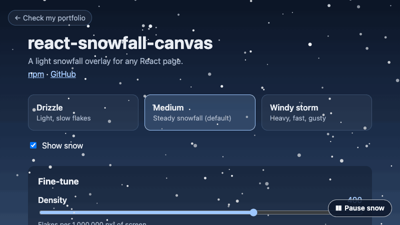

# react-snowfall-canvas

[](https://neha-pandit.com/snowfall-effect/)

**The snowfall effect that won't fail your accessibility audit.** It's a lightweight snowfall overlay for React that respects reduced motion, lets users pause it, and never gets in the way of the page.

**[Live demo →](https://neha-pandit.com/snowfall-effect/)**

## Why this one?

- **Accessible by default.** It respects `prefers-reduced-motion`, has a pause/play control for WCAG 2.2.2, is hidden from screen readers, and never blocks clicks.
- **Tiny.** About 5 KB gzipped, with no runtime dependencies.
- **One `<canvas>`**, not hundreds of DOM nodes, so the page stays fast.
- **Smooth.** Changing intensity blends gradually, and pause/play fades instead of cutting out.
- **Easy on battery.** It stops animating when the tab is hidden or the snow is paused, and caps canvas resolution at 2× on high-DPI screens.
- **Typed.** Ships TypeScript types, plus a framework-free engine if you're not using React.

## Install

```bash
npm install react-snowfall-canvas
```

## Usage

```jsx
import { Snowfall } from "react-snowfall-canvas";

<Snowfall intensity="medium" showPauseButton />
```

Put it anywhere in your app. It covers the screen without blocking anything underneath.

## Props

| Prop                   | Type                               | Default      | Description                                                                 |
| ---------------------- | ---------------------------------- | ------------ | --------------------------------------------------------------------------- |
| `intensity`            | `"drizzle" \| "medium" \| "storm"` | `"medium"`   | How heavy the snow is                                                       |
| `color`                | `string`                           | `"#ffffff"`  | Flake color (any CSS color)                                                 |
| `shape`                | `"circle" \| "snowflake" \| "mixed"` | `"circle"`   | Round dots, six-armed crystals that slowly spin, or a mix of both           |
| `density`              | `number`                           | preset value | Flakes per 1,000,000 px² of screen. Overrides the `intensity` preset        |
| `maxFlakes`            | `number`                           | preset value | Upper limit on the number of flakes. Overrides the `intensity` preset       |
| `zIndex`               | `number`                           | `9999`       | Stacking order of the overlay                                               |
| `position`             | `"fixed" \| "absolute"`            | `"fixed"`    | `fixed` covers the viewport; `absolute` fills the nearest positioned parent |
| `respectReducedMotion` | `boolean`                          | `true`       | Shows a still frame for users who turned on "reduce motion"                 |
| `showPauseButton`      | `boolean`                          | `false`      | Shows a built-in pause/play button that fades the snow out and back in      |
| `paused`               | `boolean`                          | –            | Fades the snow out and stops it; `false` fades it back in. For your own UI  |
| `onPausedChange`       | `(paused: boolean) => void`        | –            | Called when the built-in button is pressed                                  |
| `pauseButtonStyle`     | `CSSProperties`                    | –            | Extra inline styles for the built-in button                                 |
| `className`            | `string`                           | –            | Extra class for the canvas                                                  |
| `style`                | `CSSProperties`                    | –            | Extra inline styles for the canvas                                          |

## Accessibility

| WCAG success criterion | How react-snowfall-canvas handles it |
| --- | --- |
| [2.2.2 Pause, Stop, Hide](https://www.w3.org/WAI/WCAG22/Understanding/pause-stop-hide.html) (Level A) | Moving content that lasts more than 5 seconds needs a way to stop it. `showPauseButton` adds a pause/play button, or you can drive `paused` from your own control. On pause, the snow fades out and the animation stops completely. |
| [2.3.3 Animation from Interactions](https://www.w3.org/WAI/WCAG22/Understanding/animation-from-interactions.html) (Level AAA) | It uses this criterion's technique [C39](https://www.w3.org/WAI/WCAG22/Techniques/css/C39): when the user has turned on "reduce motion" (`prefers-reduced-motion`), it shows one still frame instead. It also reacts if they change the setting while the page is open. |
| [1.1.1 Non-text Content](https://www.w3.org/WAI/WCAG22/Understanding/non-text-content.html) (Level A) | The snow is decoration, so the canvas has `aria-hidden="true"` and screen readers skip it. |
| [2.1.1 Keyboard](https://www.w3.org/WAI/WCAG22/Understanding/keyboard.html) (Level A) and [4.1.2 Name, Role, Value](https://www.w3.org/WAI/WCAG22/Understanding/name-role-value.html) (Level A) | The built-in control is a native `<button>` with a visible text label ("Pause snow" / "Play snow"), so it works with the keyboard and screen readers. |

Also:

- The canvas has `pointer-events: none`, so it never blocks clicks, text selection or form fields.
- It stops animating while the tab is hidden (Page Visibility API).

### Giving users a way to stop the snow

**Pause:** the flakes keep falling while they fade out over about a second. Once they're gone, the animation stops completely, so nothing keeps moving or using CPU in the background.

**Play:** the snow fades back in and starts falling again.

Pressing play mid-fade reverses the fade smoothly. For users with "reduce motion" turned on, there is no fade: pausing hides the still frame at once and play shows it again.

WCAG 2.2.2 needs a control on the page. Either turn on the built-in button:

```jsx
<Snowfall showPauseButton />
```

…or wire up your own control with `paused`:

```jsx
const [paused, setPaused] = useState(false);

<button onClick={() => setPaused((p) => !p)}>
  {paused ? "Play snow" : "Pause snow"}
</button>
<Snowfall paused={paused} />
```

The built-in button is hidden while the snow is already still because of reduced motion.

### What's still up to you

- **Add a control.** The component can't meet 2.2.2 for you: turn on `showPauseButton` or provide your own.
- **Keep text readable.** Heavy snow over small body text can make it harder to read ([1.4.3 Contrast](https://www.w3.org/WAI/WCAG22/Understanding/contrast-minimum.html)). Use `drizzle` or a lower `density` on text-heavy pages, or `position="absolute"` to keep snow inside a banner.

## More examples

### Intensity

| `intensity`            | What it looks like                            |
| ---------------------- | --------------------------------------------- |
| `"drizzle"`            | A few small, slow flakes                      |
| `"medium"` _(default)_ | Steady snowfall with a gentle drift           |
| `"storm"`              | Heavy, fast snow blown sideways by gusty wind |

Changing `intensity` while the snow is running blends smoothly into the new mode.

### Flake shape

| `shape`               | What it looks like                                              |
| --------------------- | --------------------------------------------------------------- |
| `"circle"` _(default)_ | Soft round dots                                                |
| `"snowflake"`         | Six-armed ice crystals in three designs, each slowly spinning   |
| `"mixed"`             | Mostly dots, with the bigger flakes (about 30%) as crystals     |

```jsx
<Snowfall shape="snowflake" intensity="drizzle" />
```

Crystals are drawn larger than dots so their arms are visible, so they fill more of the screen. On text-heavy pages, pair `"snowflake"` with `drizzle` or a lower `density`.

Crystals are as fast as dots: each design is drawn once into a small cached image, and every frame just copies that image with a rotation. Changing `shape` takes effect immediately, without restarting the snow.

### Custom density and color

`density` and `maxFlakes` override the values from the chosen `intensity`, while keeping its speed, wind and flake size. The flake count is `density × screen area (in millions of px²)`, capped at `maxFlakes`. If you raise `density` and see no change, raise `maxFlakes` too.

```jsx
<Snowfall intensity="drizzle" density={200} maxFlakes={400} color="#cfe8ff" />
```

### Snow inside one element

```jsx
<div style={{ position: "relative", height: 300 }}>
  <Snowfall position="absolute" intensity="drizzle" />…
</div>
```

### Without React

The canvas engine is exported on its own:

```js
import { SnowEngine } from "react-snowfall-canvas";

const engine = new SnowEngine(canvasElement, { intensity: "storm" });
engine.start();
// engine.setIntensity('drizzle');
// engine.setOverrides({ density: 200, maxFlakes: 400 });
// engine.setColor('#cfe8ff');
// engine.setShape('snowflake');
// engine.setPaused(true);   // fade out, then stop animating
// engine.setPaused(false);  // fade back in
// engine.destroy();
```

## Development

```bash
npm install
npm run demo        # opens the demo at http://localhost:5173
npm run build       # builds the library into dist/
npm run typecheck
```

## License

MIT
